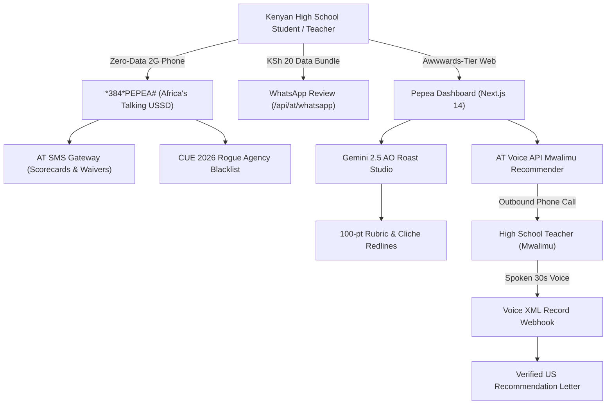

# 🇰🇪 Pepea (Ng'ambo)
### Abroad University Application Tracker & Africa's Talking Admissions Engine

> Named in tribute to the historic **Kennedy-Mboya Airlift** (1959–1963) that sent Kenya's first generation of scholars to top US universities. Pepea bridges the Kenyan 84-point KCSE system to the US 4.0 Ivy League admissions standard through **Africa's Talking USSD, Voice, SMS, WhatsApp** and **Google Gemini 2.5**.

---

## ⚡ The 72-Hour Problem Statement

* **The Timing Crisis**: Today is **October 29, 2026**. In **72 hours**, on **November 1, 2026**, Early Decision and Early Action (ED/EA) deadlines close for MIT, Harvard, Stanford, Yale, and Amherst.
* **Surging Demand vs. Tiny Mentorship**: Over **5,337 Kenyan students** study in the US (#3 in Sub-Saharan Africa, +18.4% YoY). Yet free elite access programs like KenSAP and EducationUSA accept only **15 to 40 students per year** nationwide.
* **The Predatory Scam Crisis**: In January 2026, the Commission for University Education (CUE) flagged **20 illegal student recruitment agencies** and **16 fake universities** extorting millions from Kenyan parents for forms that are 100% free.
* **The Rural Teacher Bottleneck**: US universities require 2 Teacher Recommendations. Most Kenyan public school teachers lack laptops, internet access, or experience writing holistic American recommendation letters.

---

## 🏗️ 4-Part Architecture



### 1. Zero-Data USSD Compass (`*384*PEPEA#`)
* Converts 84-point KCSE Mean Grades into US 4.0 GPA equivalents.
* Filters 100% need-met international universities (MIT, Harvard, Amherst, Williams).
* Sends instant 5-step roadmap via Africa's Talking SMS.

### 2. Dual-Channel Gemini "Admissions Officer" Roast Studio
* **Dean Eleanor Vance (Strict Ivy League AO)**: Hunts down Kenyan *Insha* composition cliches, passive platitudes, and vague "Why Us" essays.
* **KenSAP Alumni Mentor**: Contextualizes Science Congress, prefect leadership, and rural family responsibilities for American admissions committees.
* Live 100-point rubric with line-by-line micro-moment suggestions and SMS dispatch.

### 3. Voice API "Mwalimu Recommender" & Live Mock Interview
* Outbound voice call triggered to the teacher's regular mobile phone via Africa's Talking Voice API.
* Teacher speaks for 30 seconds into their phone.
* Webhook transcribes and formats the audio into a verified, US-standard recommendation letter contextualizing the KCSE grading curve.
* 60-Second live admissions / visa mock interview with speech clarity and filler-word detection.

### 4. CUE Scam-Agency Radar & $0 Fee Waiver Hub
* Real-time search across the 20 illegal agencies flagged by CUE in January 2026.
* Guidance on securing 100% free Common App and CSS Profile fee waivers for families earning under $100,000.

---

## 🚀 Quick Setup & Run Instructions

### 1. Clone & Install
```bash
git clone https://github.com/Kimanzi-Collins/GlobalEnergyHackathon.git
cd GlobalEnergyHackathon
npm install
```

### 2. Configure Environment Variables
Copy `.env.example` to `.env.local`:
```bash
cp .env.example .env.local
```
Add your credentials:
```env
AT_USERNAME=sandbox
AT_API_KEY=your_africas_talking_api_key
AT_VIRTUAL_NUMBER=+254711082000
AT_SENDER_ID=PEPEA
GEMINI_API_KEY=your_gemini_api_key
NEXT_PUBLIC_BASE_URL=http://localhost:3000
```
*(Note: If API keys are omitted, Pepea automatically runs in Demo Mode with high-fidelity mock engines for 100% demo uptime).*

### 3. Run Development Server
```bash
npm run dev
```
Open [http://localhost:3000](http://localhost:3000) to view the Awwwards-tier dashboard and USSD phone simulator.

### 4. Supabase Schema Migration (Optional)
Run `supabase/migrations/01_pepea_schema.sql` and `supabase/seed.sql` in your Supabase SQL editor to enable real-time Postgres storage.

---

## 🛠️ Tech Stack
* **Framework**: Next.js 14 (App Router, Server Actions)
* **Design & Styling**: Tailwind CSS, Instrument Serif, Space Grotesk, JetBrains Mono
* **Telco Engine**: Africa's Talking (USSD, Voice API, SMS, WhatsApp)
* **AI Engine**: Google Gemini 2.5 / 1.5 Flash (`@google/generative-ai`)
* **Database**: Supabase PostgreSQL with Realtime Subscriptions
* **Icons**: Lucide React

---

## 👥 Hackathon Team
Built with passion for Kenyan scholars applying worldwide.
* **License**: MIT
