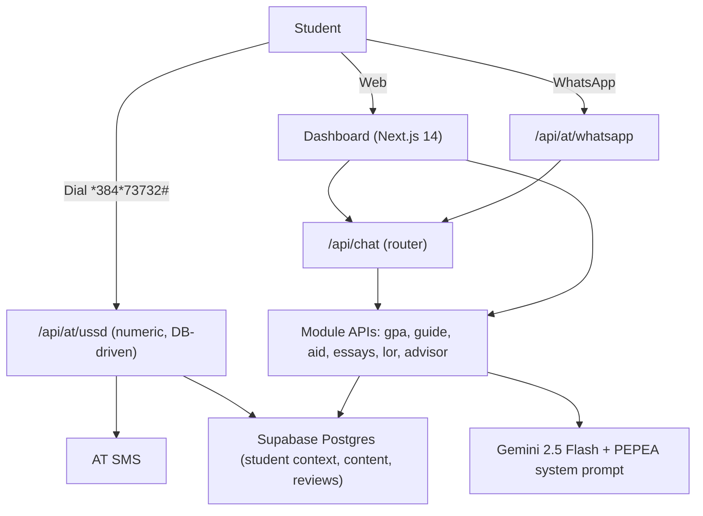

# Pepea (Ng'ambo)
### A free, full-cycle US admissions assistant for Kenyan students, on Africa's Talking USSD, SMS and WhatsApp, powered by Gemini

> *Ng'ambo* means "the other side". Named in tribute to the Kennedy-Mboya Airlift (1959-1963) that sent Kenya's first generation of scholars to US universities. Pepea bridges the Kenyan 84-point KCSE system to US admissions, on any phone.

**Status:** specification phase. The task board is in [AGENTS.md](AGENTS.md), the design system in [DESIGN.md](DESIGN.md).

---

## The problem

- **Timing:** Early Decision and Early Action deadlines close on **November 1, 2026** for most selective US schools.
- **Demand vs mentorship:** over 5,337 Kenyan students study in the US, yet free programmes such as KenSAP and EducationUSA admit very few students a year.
- **Scams:** in January 2026 the Commission for University Education flagged 20 illegal recruitment agencies and 16 unaccredited universities charging families for steps that are free.
- **Grading mismatch:** US readers do not know what 82 out of 84 means.

## The six modules

| # | Module | What it does |
|---|---|---|
| 1 | **Application Guide** | Step-by-step guidance from "how US admissions work" to the visa, tracked per student |
| 2 | **GPA Converter** | KCSE grade, points or subjects to an indicative US 4.0 GPA |
| 3 | **Financial Aid Scout** | Matches the student to need-based aid, fee waivers and programmes, with forms and deadlines |
| 4 | **Essays and LOR Review** | Essays are split by **type** (personal statement, why-us, community, scholarship, ...) and by **school** (each school's own prompts). Recommendation letter drafts get structured feedback |
| 5 | **University Advisory** | Reach / target / likely shortlist with aid outlook, from the student's profile |
| 6 | **Student Context** | One profile per phone number that every module and every Gemini call reads, shared across channels |

Plus the **CUE scam radar** (free-text name check against the CUE list) and a **voice mock interview**.

## Channels (all live)

| Channel | Provider | Notes |
|---|---|---|
| USSD | Africa's Talking | Numeric code **`*384*73732#`** (Kenyan handsets cannot dial letters). Digit-only menus, no AI in the loop (3 s limit) |
| SMS | Africa's Talking | Scorecards, next steps, deadlines |
| WhatsApp | Africa's Talking | Conversational assistant, replies sent through AT |
| Voice | Africa's Talking | Mock admissions interview only. The teacher recommendation call flow was removed |
| Web | Next.js 14 | Dashboard and landing page |

AI: **Google Gemini 2.5 Flash**, with the system prompt in `lib/prompts/system-prompt.ts`.

## Architecture



## Repository layout

```
app/                 Next.js routes and API handlers (backend lives in app/api)
components/          UI components
lib/                 shared code: types.ts, constants.ts, prompts/, AT and Supabase clients
supabase/migrations/ 01_pepea_schema.sql, 02_pepea_modules.sql
supabase/            seed.sql, seed_02_modules.sql
AGENTS.md            task board, ownership, contracts, review gates
DESIGN.md            design system and storyboard
```

## Setup

```bash
git clone https://github.com/Kimanzi-Collins/GlobalEnergyHackathon.git
cd GlobalEnergyHackathon
npm install
cp .env.example .env.local
npm run dev
```

Environment variables (see `.env.example`):

```env
AT_USERNAME=sandbox
AT_API_KEY=your_africas_talking_api_key
AT_VIRTUAL_NUMBER=your_at_number
AT_SENDER_ID=PEPEA
GEMINI_API_KEY=your_gemini_api_key
NEXT_PUBLIC_SUPABASE_URL=...
NEXT_PUBLIC_SUPABASE_ANON_KEY=...
SUPABASE_SERVICE_ROLE_KEY=...
NEXT_PUBLIC_BASE_URL=http://localhost:3000
NEXT_PUBLIC_DEMO_MODE=false
```

`NEXT_PUBLIC_DEMO_MODE=true` serves mock responses (for a venue with no Wi-Fi) and must show a visible "Demo mode" label. In live mode a failed AT, Gemini or database call returns an error instead of a fake success.

Database: in the Supabase SQL editor run, in order, `01_pepea_schema.sql`, `02_pepea_modules.sql`, `seed.sql`, `seed_02_modules.sql`.

Local webhooks: expose the dev server with ngrok and set the AT USSD, SMS and WhatsApp callback URLs to the ngrok address plus the secret query parameter described in AGENTS.md (BE-LIB-06).

## Team

| Person | Area |
|---|---|
| Geoffrey Obwocha | Backend: database, USSD, SMS, GPA, guide, shared libs |
| Esther Irungu | Backend: Gemini, WhatsApp, essays, LOR, advisory, aid |
| Collins Kimanzi | Frontend: design system, landing page, USSD simulator |
| Sandra Wanjie | Frontend: dashboard and module interfaces |

Pepea gives guidance, not guarantees. GPA conversions are indicative and school and aid data must be confirmed on official sites.

License: MIT
